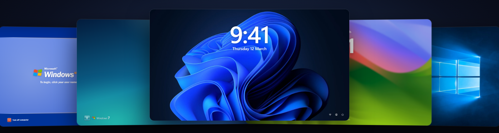
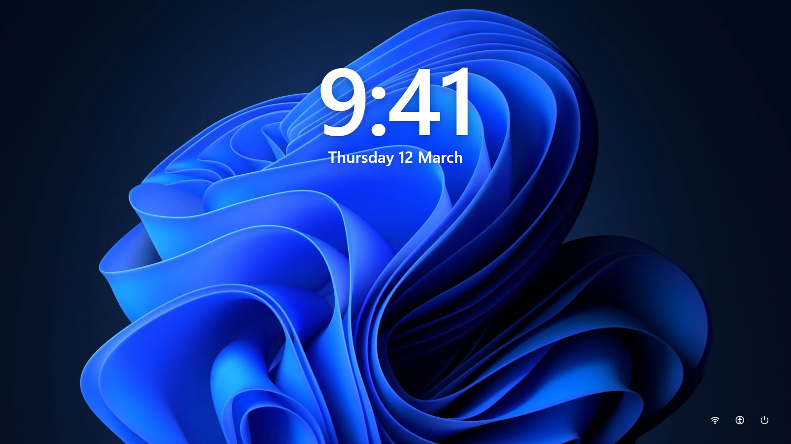
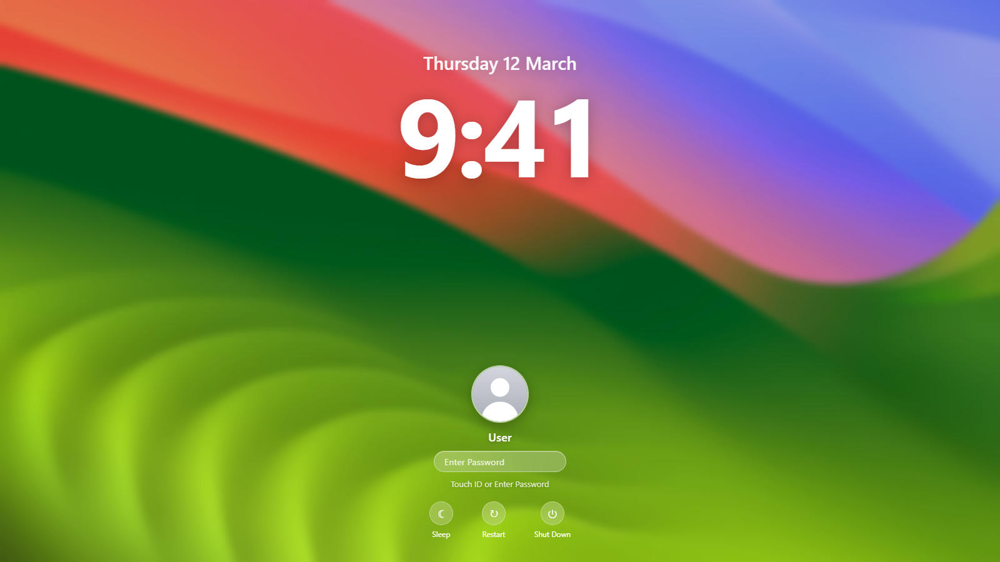
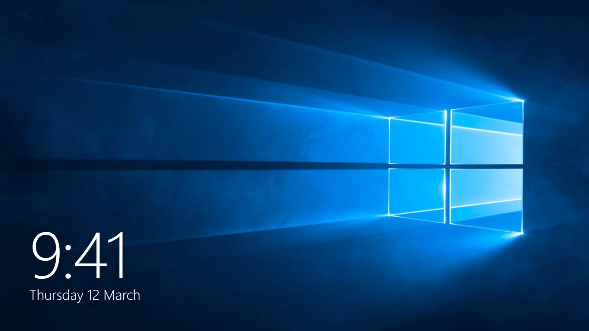
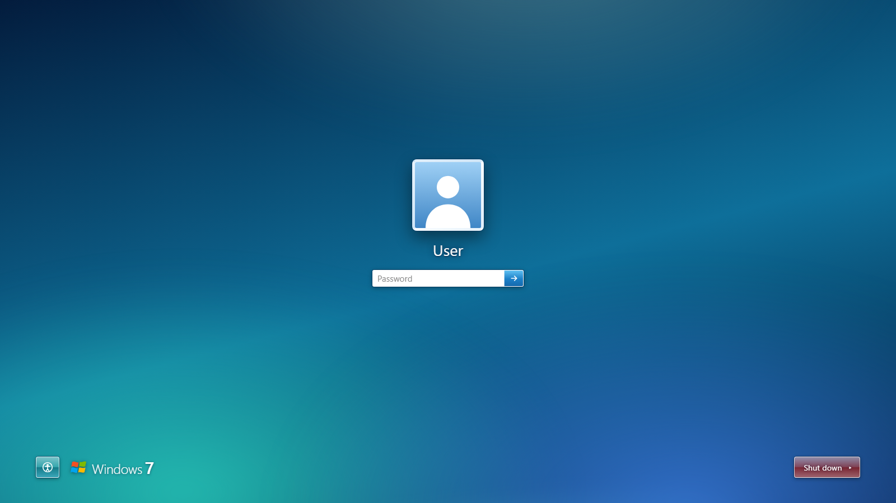
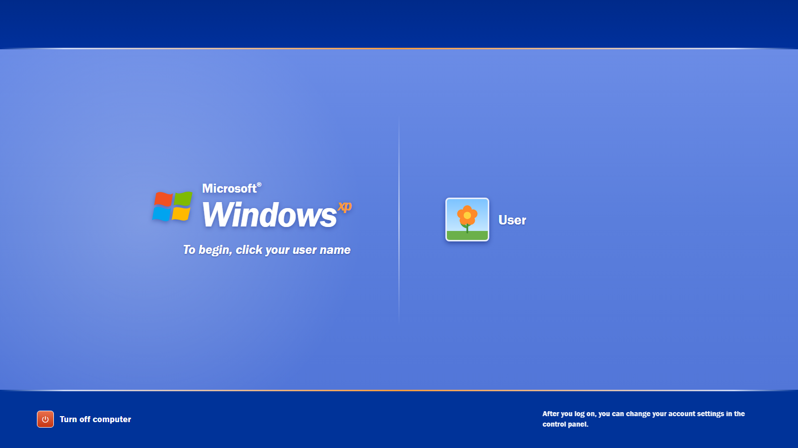
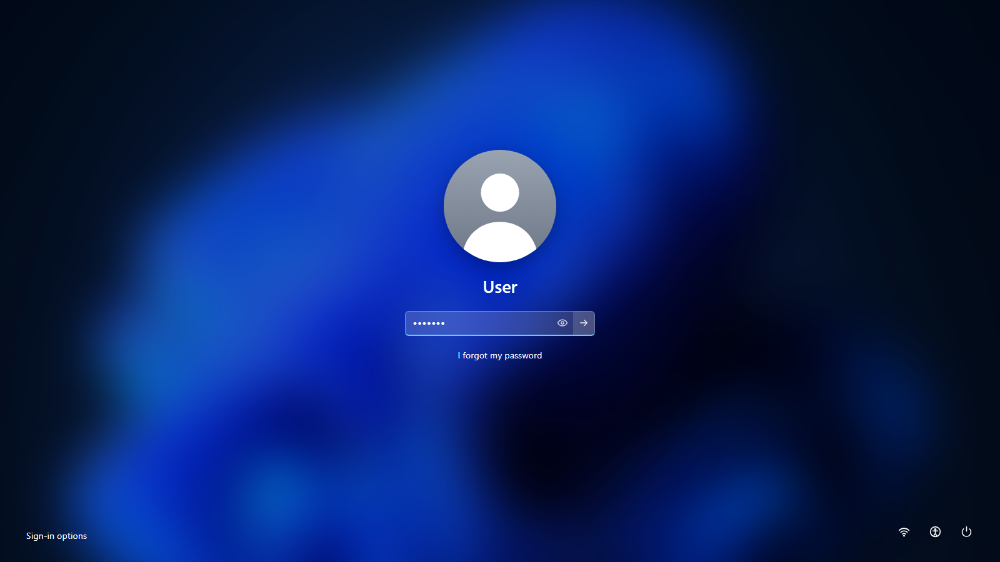
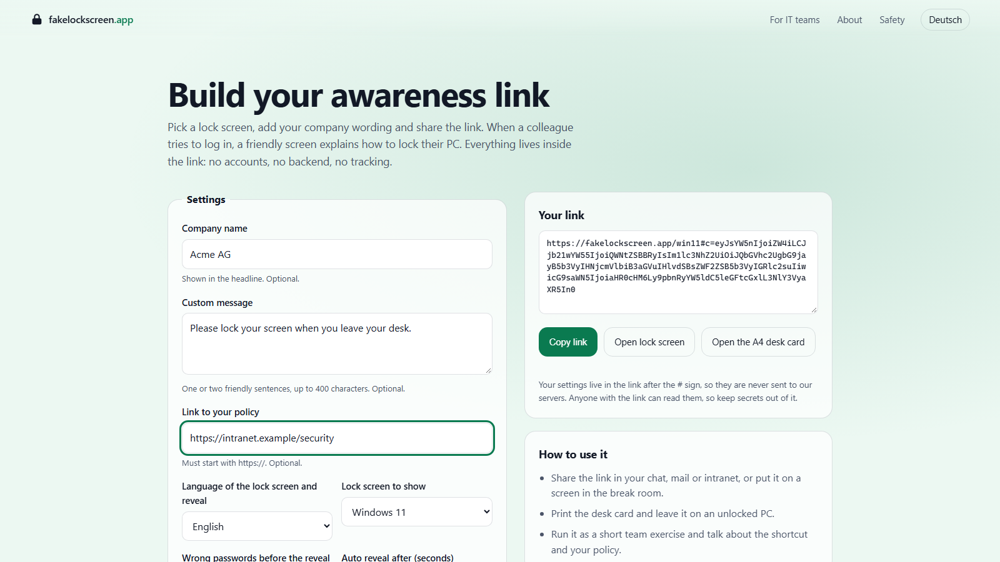
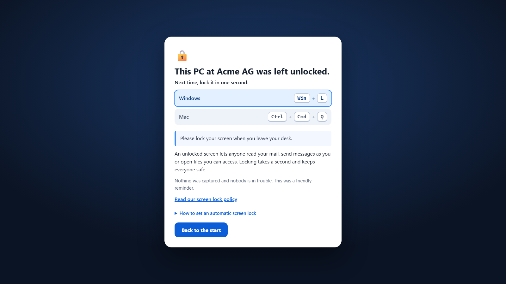
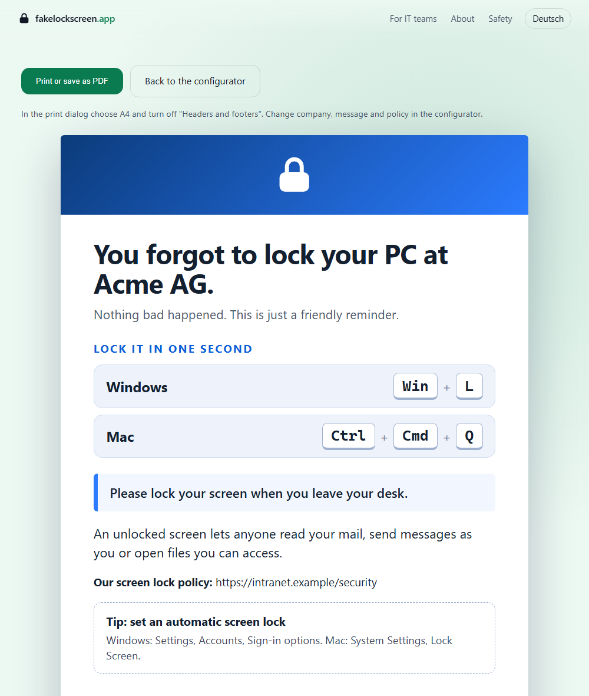

<div align="center">



# fakelockscreen.app

**Windows XP, 7, 10, 11 and macOS lock screens in your browser.**<br>
A harmless prank, and a friendly nudge to press <kbd>Win</kbd> + <kbd>L</kbd>.

[**Live site**](https://fakelockscreen.app) · [Deutsch](https://fakelockscreen.app/de) · [For IT teams](https://fakelockscreen.app/awareness) · [Safety](https://fakelockscreen.app/safety)


</div>

## What it is

Open a page, click start, and your browser turns into a convincing lock screen: login box, clock, wallpaper, wrong-password shake and all. Leave it on a colleague's desk, or use it on purpose.

- **Five lock screens:** Windows XP, 7, 10, 11 and macOS, drawn from scratch in CSS and SVG.
- **Awareness mode for IT teams:** build a link with your own company name, message and policy URL. After a few wrong passwords the screen reveals itself and teaches the real shortcut (<kbd>Win</kbd> + <kbd>L</kbd> or <kbd>Ctrl</kbd> + <kbd>Cmd</kbd> + <kbd>Q</kbd>). A printable A4 desk card is included.
- **Your own wallpaper:** pick a local image. It is resized in the browser and never uploaded.
- **English and German**, no accounts, no cookies, no analytics.

## See it in action

<table>
  <tr>
    <td width="50%"><br><sub><b>Windows 11</b> lock screen</sub></td>
    <td width="50%"><br><sub><b>macOS</b> lock screen</sub></td>
  </tr>
  <tr>
    <td width="50%"><br><sub><b>Windows 10</b> lock screen</sub></td>
    <td width="50%"><br><sub><b>Windows 7</b> logon screen</sub></td>
  </tr>
  <tr>
    <td width="50%"><br><sub><b>Windows XP</b> welcome screen</sub></td>
    <td width="50%"><br><sub>Sign-in with a (never stored) password</sub></td>
  </tr>
</table>

### Awareness mode for IT teams

1. **Build a link** with your company name, message and policy URL.
2. **Share it** in chat or mail, or leave the printable desk card on an unlocked PC.
3. **After a few wrong passwords** the screen reveals itself and teaches the real shortcut.

<table>
  <tr>
    <td width="45%"><br><sub>Configurator with live link</sub></td>
    <td width="30%"><br><sub>The friendly reveal</sub></td>
    <td width="25%"><br><sub>Printable A4 desk card</sub></td>
  </tr>
</table>

## Safety by design

These rules are enforced by the test suite, so they cannot quietly break.

| Rule | How |
|---|---|
| No form fields | Lock screens contain no `input`, `form` or `textarea`. Typed characters are counted, never stored, logged or sent. |
| Zero network | No requests after load. CSP `connect-src 'none'` on all lock screen routes. |
| Strict CSP | All scripts are external same-origin files (`script-src 'self'`), no inline scripts. |
| Always escapable | Holding <kbd>Esc</kbd> for 2 s exits. No Keyboard Lock API, fullscreen only after a click. |
| Private config | Awareness settings live in the URL hash (`#c=...`), which browsers never send to a server. They are sanitised and rendered with `textContent` only. |
| Honest labelling | Every page states that it is a harmless prank and affiliated with nobody. See [Not affiliated](#not-affiliated). |

Found a vulnerability? Please use a [private security advisory](https://github.com/FlorianSLZ/FakeLockscreen.app/security/advisories/new).

## Tech stack

[Astro](https://astro.build) with TypeScript, static output, no UI framework. The lock screen engine is vanilla TypeScript. Tests run on [Playwright](https://playwright.dev) with axe for accessibility. Hosted as static assets on Cloudflare Workers.

## Getting started

```bash
git clone https://github.com/FlorianSLZ/FakeLockscreen.app.git
cd FakeLockscreen.app
npm install
npm run dev        # http://localhost:4321
```

| Command | What it does |
|---|---|
| `npm run dev` | Dev server on localhost:4321 |
| `npm run build` | Static build into `dist/` |
| `npm run preview` | Serve `dist/` |
| `npm test` | Build, preview and run all Playwright tests |
| `npm run shots` | Regenerate the README screenshots in `docs/screenshots/` (needs `npm run preview` running) |
| `npm run og` | Regenerate `public/og/*.png` (needs a local font such as Segoe UI) |

Tests run against the built `dist/`, so run `npm test` rather than testing against a stale preview server.

## Project structure

```
src/pages/            thin routes (EN at /, DE under /de)
src/views/            one view per page, takes a `lang` prop
src/layouts/          Base (normal pages) and Lock (fullscreen lock screens with start gate)
src/lockscreens/      core engine + one folder of CSS per OS
src/i18n/             all copy (EN, DE with Swiss spelling)
src/lib/config-codec  share link config, stored in the URL hash only
public/_headers       CSP and security headers
public/.well-known/   security.txt
```

## Deploy

Deployed with Cloudflare Workers Builds on every push to `main`: build command `npm run build`, deploy command `npx wrangler deploy`, worker name `fakelockscreen-app` (see `wrangler.jsonc`). After deploying, `curl -I https://fakelockscreen.app/xp` must show `connect-src 'none'` in the CSP header.

## Contributing

Issues and pull requests are welcome. Please keep the safety rules above intact and run `npm test` before opening a PR. New pages need both an English and a German route, strings, an OG image and (for lock screens) a `_headers` block. German text uses Swiss spelling and never the sharp s.

## Not affiliated

Not affiliated with Microsoft or Apple. Windows and Microsoft are trademarks of the Microsoft group of companies; macOS and Apple are trademarks of Apple Inc. The lock screens are drawn from scratch in CSS and SVG, but they use some third-party assets, such as the Windows logos and the default wallpapers in `public/wallpapers/`. Those belong to their owners and are **not** covered by the MIT license.

## License and author

Code is released under the [MIT License](LICENSE).

Made by [Florian Salzmann](https://www.linkedin.com/in/fsalzmann/) · [scloud.work](https://scloud.work)
